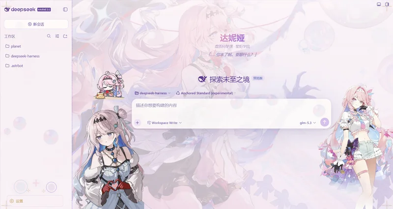
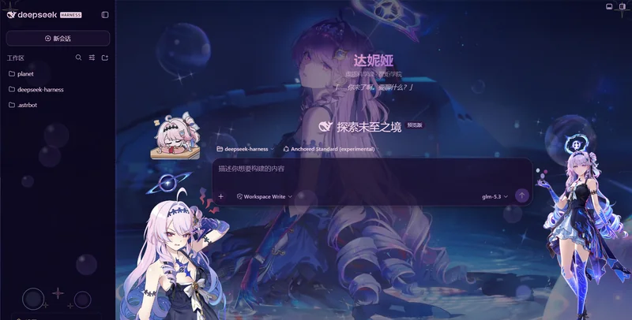

# dsh-client-ui-skin-denia · 达妮娅 · 虚无之泡

> **本包 v2.0.0 · 插件 id `ui-skin-denia-rewrite`。**
> 它与上游原版（`ui-skin-denia`）、以及「设置页版」变体
> （`ui-skin-denia-settings`）可以并列安装，但**同一时间只能启用一个皮肤**——
> 三者共用同一套 CSS/DOM 覆盖与 `/api/dsh-denia/palette-settings` 路由。
> 本仓库是上游 v1.0.0 的 fork：重写了宿主/客户端结构（见下文对照表），
> 图片改为外链资源、设置搬进 DSH 设置页、立绘移到文字之下、桌宠可拖动并锁定。


DeepSeek Harness Web GUI 的鸣潮达妮娅主题皮肤。

> 本仓库是 [Ewnscat-ya/dsh-client-ui-skin-denia](https://github.com/Ewnscat-ya/dsh-client-ui-skin-denia) v1.0.0 的 fork，
> 面向 DSH 桌面端 0.2.1 重写了宿主/客户端结构（见「与上游的差异」）。

## 效果预览

| 布景之形（亮色） | 幻灭之形（暗色） |
|---|---|
| [](preview/light.webp) | [](preview/dark.webp) |

## 特性

- **双形态切换**：布景之形（亮色）/ 幻灭之形（暗色），含形态切换动画
- **左右全身立绘** + Q版动态 GIF 桌宠
- **玻璃卡片层级**：背景图 → 立绘 → 磨砂遮罩 → 应用内容，四层分离
- **泡泡粒子场**：前后两层虹彩气泡，纯 CSS 动画
- **锁链边框**：跟随侧栏宽度
- **渐变文字**：工作区 / 会话标题
- **装饰条 + 四角星**：侧边栏彩虹装饰
- **深色 / 浅色按钮文字替换**：布景之形 / 幻灭之形

## 与上游 v1.0.0 的差异

### 1. 设置搬进 DSH 设置页

右下角的 🎨 调色板面板已移除，全部设置改为一个设置页：
**设置 → 达妮娅主题**（客户端注册在 `settings.section` 槽位）。
所有改动即时生效，并保存到当前 profile 的
`data/dsh-client-ui-skin-denia/palette-settings.json`。

### 2. 桌宠可拖动 + 位置锁定

- 桌宠默认可直接拖动（指针捕获，5px 阈值，不会把点击误判成拖动）
- 位置以像素坐标持久化，窗口缩放时自动收进可视区
- 设置页新增「锁定位置」开关；配置文件也可以强制锁定（见下）
- 设置页「重置位置」回到默认锚点

在 `cordis.patch.yml` 中还可以用配置项强制锁定（优先级高于界面开关）：

```yaml
- insert:
    - id: ui-skin-denia
      name: '@dsh-external/dsh-client-ui-skin-denia'
      config:
        lockPet: true
```

### 3. 立绘改为「背景之上、文字之下」

上游把立绘放在 `position:fixed; z-index:0` 的独立图层里。因为定位元素的
绘制顺序晚于行内文字，立绘会压住正文。本 fork 改用负 z-index 分层：

| 层 | 内容 | z-index |
|---|---|---|
| 页面底色 | `body` 背景色 | — |
| 舞台 | 背景图 + 背面泡泡 + 左右立绘 | `-2` |
| 遮罩 | 磨砂渐变（原 `[id=root]` 的玻璃底） | `-1` |
| 应用 | `#root` 及其全部内容 | 自动 |

立绘因此永远在文字下面，也不会因为抬升 `#root` 而把 `body` 下的弹层压住。

### 4. 性能与实现方式

| 上游做法 | 本 fork |
|---|---|
| 8 张图片以 base64 内联在 `client.js`（约 2.4 MB） | 图片作为 `assets/*.webp`、`*.gif` 由宿主路由提供（`/api/dsh-denia/assets/…`，ETag + 304），`client.js` 约 60 KB |
| 每次 DOM 变动全文档扫描按钮、会话行、工作区树并打标记 | 会话行改用 `[role='treeitem'][aria-selected]` 等属性选择器；只有「消息文本框」开启时才扫描会话视图，且每个动画帧最多一次 |
| 500 ms 定时轮询判断 DevTools / 右侧栏 | 删除轮询。右侧栏用 `ResizeObserver` 观察列宽；DevTools 检测移除（纯调试便利功能） |
| 欢迎页文案 DOM 注入 + 定时重试 | 移除（直接写 React 管理的节点不可靠，且需要重试链） |
| 调色板面板每次重建全部控件 | 设置页由 React 管理，状态走一个订阅式 store |
| 泡泡数量变化时重建节点 | 固定 40 个节点，用 `hidden` 显示前 N 个 |

注：皮肤本质上是全局 CSS 覆盖，因此样式表与「必须在 `#root` 之下」的舞台层
仍以 DOM 方式安装；其余交互（设置页、桌宠）都走 React 槽位，随插件卸载自动清理。

## 安装

```sh
# 从本目录打包安装（构建产物已随包提供，无构建步骤）
npm pack
dsh plugin --profile <profile> add ./dsh-external-dsh-client-ui-skin-denia-2.0.0.tgz
```

请用压缩包安装，不要用目录直接 `add`：pnpm 对目录使用 link 语义，
之后 `remove` 会连带清空被链接的目录。

安装或替换后需**重启 DSH**（宿主侧新增了图片路由与设置字段白名单），刷新页面即可。

## 设置项

| 分组 | 项 | 范围 / 默认 |
|---|---|---|
| 当前形态 | 左立绘 / 右立绘 / Q版桌宠 | 开 |
| 当前形态 | 背景图上传 / 清除 | PNG·JPEG·WebP·GIF（自动裁剪 + 压缩到 1920px，JPEG 0.85） |
| 布局 | 对话宽度 | 500–1000px（780） |
| 布局 | 立绘高度 | 30–80vh（55） |
| 布局 | 立绘水平偏移 | −50–50px（0） |
| 布局 | 背景不透明度 | 20–100%（100） |
| 效果 | 泡泡粒子场 / 数量 / 速度 | 开；5–40（20）；30–200%（100） |
| 效果 | 锁链边框 / 装饰条 | 开 / 开 |
| 消息 | 消息文本框 / 不透明度 / 文字配色 | 关；20–100%（68）；关 |
| 桌宠 | 显示 / 大小 / 锁定位置 / 重置位置 | 开；60–240px（110）；关 |

亮色与暗色的立绘、背景图分开记忆。

## 已知边界

- 桌面端右上角系统按钮区（最小化/关闭）的底色由官方启动参数写死，
  DOM、主进程 API、theme-color 三种方式都改不动；装饰条停靠在它左缘。
- `dsh.client.version` 声明为 `0.1.0-rc.6 - 0.2.2-alpha.2`，但 DSH 对第三方客户端
  插件的版本声明只作提示；DSH 升级后仍应复核内部类名（`_centerCol`、`_viewArea`、
  `_composerSeat`、`rightbarCol`、`data-chat-flow-kind` 等）。
- 删除上游的「欢迎页文案注入」与「DevTools 打开时淡出立绘」两项，原因见上表。
- **不要在桌面端用 Ctrl+R 重载渲染进程**：该构建重载后会丢掉启动载荷，
  页面只剩皮肤图层、React 树不再挂载（白屏），只能退出重开。更换插件版本后
  请直接重启 DSH。

## 版权所有人

| 版权所有人 | 版权所有内容 |
|---|---|
| Kuro Games（库洛游戏） | 「鸣潮」游戏作品及达妮娅（Denia）角色形象原作 |
| Ewnscat | 皮肤覆盖层实现（CSS 配色、SVG 装饰、DOM 装饰逻辑） |
| 本 fork 维护者 | 宿主路由、设置页、桌宠拖动与锁定、分层与性能重构 |

\*背景 / 角色 / 画框素材及预览截图来自用户本地素材库。本皮肤为同人创作，与 Kuro Games 无关联。

## 许可

本仓库以上游相同的 **CC BY-NC-SA 4.0**（署名-非商业性使用-相同方式共享）发布，禁止商业性使用。署名链见 `NOTICE`。

Character "Denia" (达妮娅) and "Wuthering Waves" (鸣潮) are trademarks of Kuro Games. This skin is a fan work and is not affiliated with or endorsed by Kuro Games.
